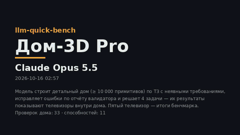
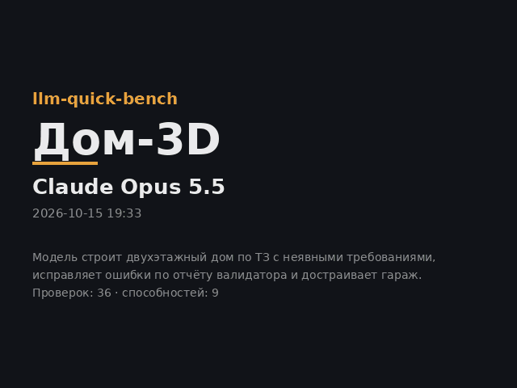

# llm-quick-bench · Дом-3D

Быстрый комплексный бенчмарк для новых LLM. Модель проектирует и строит дом из 3D-примитивов, исправляет ошибки по отчёту валидатора и решает головоломки. На выходе получается **видео (GIF/MP4)**: по нему за минуту складывается короткое, но показательное мнение о модели.

Есть два трека:
- **Pro** (`python -m qbench pro`) — детальный дом не меньше чем из 10 000 примитивов, 33 проверки и 4 набора головоломок. В ролике камера влетает в дом, а на пяти телевизорах показаны результаты.
- **Базовый** (`python -m qbench run`) — дом из ~100–300 примитивов, 27 + 8 проверок и тест зрения. Топ-модели проходят его почти на 100%.

[Лидерборд](results/LEADERBOARD.md)

## Дом-3D Pro



[Отчёт Opus 5.5 Pro](results/claude-opus-5.5-pro/2026-10-16/report.md) · [MP4](results/claude-opus-5.5-pro/2026-10-16/video.mp4)

Модель строит детальный дом: после развёртки не меньше 10 000 примитивов, то есть в 100 раз больше, чем в базовом треке. Затем она исправляет ошибки по отчёту валидатора и решает 4 набора головоломок.

В ролике:
1. камера облетает дом и влетает внутрь через входную дверь;
2. по очереди подлетает к пяти телевизорам;
3. на ТВ 1–4 показаны наборы головоломок, на ТВ 5 — итоги самого бенчмарка.

### Прогон Claude Opus 5.5 — 82%

| Часть | Результат |
|---|---|
| Дом, 33 проверки | **33 из 33 с первой попытки**; 11 467 примитивов — ровно столько модель заявила в `plan` |
| Логика (ARC), набор из 8 | 100% |
| Оптика, набор из 5 | 100% |
| Навигация, набор из 5 | **0%: ответа нет** — 4 попытки по 128k токенов |
| Кубик, набор из 4 | **0%: ответа нет** — 4 попытки по 128k токенов |
| Те же 22 головоломки по одной | 22 из 22 (диагностика, в счёт не идёт) |

**Мнение в двух абзацах.** Opus 5.5 проектирует без ошибок. Неявные требования он вывел сам:
- пандус 1:20 с площадкой у входа со стороны улицы;
- П-образную лестницу из 17 подъёмов по 0.1765 м с поручнями и балясинами;
- солнечную гостиную на юг;
- эвакуационные окна в спальнях.

Пять телевизоров он развёл по нормам обзора, а число примитивов предсказал до штуки.

Любую головоломку по отдельности Opus решает идеально, даже кратчайший обход «почтальона» на 9 ящиков. Но набор из 4–5 задач одним ответом не сдаёт. Решения у него уже собраны, а он снова и снова перепроверяет их посимвольно и ищет маршрут на ход короче, пока не кончится лимит.

Как шёл прогон:
- **Ручной режим.** Каждый запрос — отдельный субагент Claude Code без инструментов. Модель видела только текст задания (одно чтение файла с промптом), код проверок ей был недоступен. Уровень рассуждений — по умолчанию для субагента.
- **Ответы на наборы** взяты из прогона 15–16.10 ([попытка 2](results/claude-opus-5.5-pro/attempt2-whole-sets/NOTES.md)): его промпты побайтно совпадают с официальными. Дом и диагностика «по одной» — прогон 16.10.
- **Перезапуск контейнера** оборвал три запроса до ответа: часть 1 дома, кубик 4 и оптику 1. Их задали заново теми же промптами.
- **Правки валидатора.** На доме Opus нашлись три ошибки валидатора, и все три занижали оценку модели:
  - промежуточная площадка П-образной лестницы не считалась уровнем марша;
  - дверь, нарисованная открытой, не находилась на фасаде;
  - покрытие черепицей мерилось на сетке, которая совпадала с шагом плиток и считала зазоры по 5 мм за 15% площади.

  Эталонный дом по-прежнему проходит 33 из 33.
- **Калибровка** под Opus 5.5 шла открыто. Базовый трек он прошёл на 100%, наборы головоломок затем усложнялись (сложность 1 → 2 → 3). Официально: сложность 3, seed 2026. Самокоррекция не измерена: исправлять было нечего.

### Что делает модель

1. **Дом из четырёх частей.** ТЗ состоит из 17 пунктов, дом сдаётся четырьмя ответами:
   - каркас;
   - проёмы и крыша;
   - интерьер;
   - участок и итоговый `plan`.

   Бенчмарк склеивает части по `id`. В языке сцены есть компоненты, вложенные экземпляры, массивы `array`/`grid` и повороты `rot`/`yaw`.
2. **Самокоррекция.** Валидатор присылает список несоответствий, модель отвечает патчем: заменяет объекты по `id`, удаляет через `remove`, добавляет недостающее.
3. **Четыре набора головоломок, каждый одним ответом:**
   - **ARC** (8 задач) — найти скрытое правило по трём примерам и применить его;
   - **Оптика** (5 полей) — трассировка лучей с делителями и подбор зеркал;
   - **Навигация** (5 уровней) — лёд, порталы, ключи и двери, сокобан на 4 ящика и «почтальон» на 9 ящиков с кратчайшим обходом;
   - **Кубик** (4 задачи) — 100 ходов симуляции с покраской, поворотными кругами и переворотами плюс три поиска кратчайшего маршрута к нужной ориентации.

33 проверки дома меряют требования ТЗ по геометрии сцены:
- **явные:** габариты, отметки, черепица на 95% крыши, 5 телевизоров 16:9 с обзором с дивана, стола и кроватей;
- **неявные:** вход с улицы, пандус и маршрут коляски по нормам для мамы-колясочницы, солнечный фасад для гостиной, эвакуационные окна;
- **проходимость:** маршрут считается на сетке занятости с учётом радиуса коляски, нужна площадка разворота 1.5 м;
- **физика:** ничего не висит в воздухе;
- **план ↔ дело:** числа, заявленные в `plan`, совпадают с построенным.

Итог — среднее по 12 способностям:
- **8 по дому:** формат, ТЗ, пространство, неявные выводы, физика, детализация, план ↔ дело, самокоррекция;
- **4 по наборам:** логика, симуляция, поиск плана, вращение 3D.

Способности дома меряются по **первой** попытке, самокоррекция — по доле исправленных ошибок.

### Почему наборы — одним ответом, а дом — частями

Каждый запрос ограничен 128 000 токенов вывода, и рассуждения входят в этот лимит. Модели об этом сообщают. Если лимит кончился раньше ответа, запрос повторяют, всего до 4 попыток, как делает Claude Code. Каждое превышение пишется в отчёт.

- **Набор из 4–8 задач одним ответом** — обычный формат экзамена: распределить рассуждения между задачами и вовремя остановиться — часть умения. Именно здесь Opus и проваливается, хотя по одной решает всё. Это самый показательный результат прогона, поэтому он и идёт в счёт. Режим «по одной» включается флагом `--item-diag` и остаётся диагностикой.
- **Дом одним ответом** Opus не сдал ни разу. Ответ — это 60 тыс. символов JSON, а до него ещё нужно продумать всю планировку, и вместе они не помещаются в 128k: модель так и не начинала писать. Стройку естественно делить на этапы, как в реальном проекте.

Протокол сложился за две неудачные попытки. Обе записаны:
- [**Попытка 1**](results/claude-opus-5.5-pro/attempt1-no-budget/NOTES.md): правила о лимите ещё нет. Дом, навигация и кубик — 4 из 4 попыток по 128k без ответа.
- [**Попытка 2**](results/claude-opus-5.5-pro/attempt2-whole-sets/NOTES.md): правило о лимите и частичные баллы добавлены. ARC и оптика сданы, навигация и кубик — снова без ответа, дом одним ответом — тоже.

### Запуск

```bash
python -m qbench pro --model mock                                     # демо без API
python -m qbench pro --model <provider>/<model> --label "Модель X"    # OpenRouter и др.
python -m qbench pro --model x --label "Модель X" --manual results/x/pro --item-diag   # ручной режим
```

Флаги:
- `--max-tokens 128000` — лимит вывода, задан по умолчанию;
- `--overrun-retries 3` — сколько раз повторить запрос после превышения лимита;
- `--puzzles items` — головоломки по одной на запрос вместо наборов;
- `--item-diag` — наборы плюс диагностика «по одной»;
- `--seed` — номер набора головоломок.

В ручном режиме все ожидающие промпты пишутся сразу, на них можно отвечать параллельно. Каждый запуск воспроизводит уже полученные ответы и выдаёт следующие промпты. Части дома 2–4 и исправление — продолжение одного диалога. Если рядом с ответом лежит `NN_*.meta.json` с полями `out`, `seconds` и `overruns`, токены и превышения лимита попадают в отчёт.

Экземпляры головоломок генерируются из seed 2026 и лежат в `qbench/hard/data/`. Ответы открыты, поэтому для свежих моделей seed лучше менять (`--seed 7` и т. п.); генерация нового набора занимает несколько минут.

## Базовый трек



[Отчёт Opus 5.5](results/claude-opus-5.5/2026-10-15/report.md)

Модель строит двухэтажный дом из ~100–300 примитивов, исправляет ошибки по отчёту валидатора и перестраивает дом под изменённое ТЗ — пристраивает гараж.

**Первый прогон: Claude Opus 5.5 — 100%.** Модель с первой попытки прошла все 27 базовых проверок, 8 проверок гаража и визуальный тест. При пристройке гаража она сама перенесла пандус на запад, чтобы освободить въезд. Для моделей этого уровня задача упирается в потолок, поэтому появился трек Pro.

Правки валидатора по ходу прогона:
- G6 теперь проверяет и свободный проезд от ворот к улице;
- G8 считает сохранность только по самому дому.

| Способность | Что проверяется |
|---|---|
| Формат | строгий JSON, корректная схема ~100–300 объектов |
| Следование ТЗ | габариты, отметки этажей, крыша, балкон, цвета |
| Пространство | замкнутые стены, окна в плоскостях фасадов, ориентация по сторонам света |
| Математика | лестница по нормам (подъём/проступь), уклоны, высоты |
| **Неявные выводы** | требования, которые прямо не названы, а следуют из контекста и норм |
| Физика | ничего не висит в воздухе, труба проходит сквозь кровлю, ограждения |
| План ↔ дело | совпадает ли заявленное в `plan` с построенным |
| Адаптация | пристройка гаража без регрессий |
| Самокоррекция | какую долю ошибок модель исправляет по отчёту валидатора |
| Зрение | *(опционально)* подсчёт окон и поиск отличий на рендерах |

Ни один бенчмарк не измеряет AGI напрямую. Этот проверяет признаки обобщения:
- вывод неявных требований;
- перенос норм из реального мира;
- согласованность плана и исполнения;
- работу с обратной связью;
- устойчивость к изменениям ТЗ.

```bash
pip install -e ".[mp4]"          # numpy, Pillow, requests, scipy (+ imageio-ffmpeg для MP4)
python -m qbench demo            # демо на mock-модели, без API
export OPENROUTER_API_KEY=...
python -m qbench run --model <provider>/<model> --label "Моя модель" --vision
python -m qbench run --model <model> --base-url https://api.openai.com/v1 --api-key-env OPENAI_API_KEY
python -m qbench run --model qwen2.5:14b --base-url http://localhost:11434/v1 --max-tokens 0   # Ollama и т. п.
python -m qbench run --model <model> --extra '{"reasoning": {"effort": "high"}}'
python -m qbench run --model my-model --label "Модель X" --manual results/model-x/run1 --vision
python -m qbench prompt | validate scene.json | render scene.json -o house.png | video <папка прогона> | leaderboard
```

Результаты появляются в `results/<модель>/<время>/`:

| Файл | Что это |
|---|---|
| `video.gif`, `video.mp4` | ролик |
| `report.md`, `run.json` | все проверки с диагностикой и сырые данные |
| `dialog/`, `responses/` | промпты и ответы модели |

`results/LEADERBOARD.md` обновляется автоматически. Качество видео задаётся флагом `--quality fast|normal|high`.

## Устройство

```
qbench/
  cli.py            команды run, pro, prompt, validate, render, video, leaderboard
  llm.py            OpenAI-совместимый клиент (с учётом превышений лимита), ручной режим, mock
  prompts.py, scene.py, checks.py, runner.py, vision.py, reference.py   базовый трек
  hard/             трек Pro
    prompts.py      ТЗ дома, части 1–4, обратная связь, правило о лимите
    dsl.py          DSL v2: компоненты, массивы, повороты; склейка частей и патчей
    house_checks.py 33 проверки дома
    spatial.py      сетки занятости, проходимость, касания
    reference.py    эталонный дом (≈ 12 000 примитивов, проходит 33/33) и испорченный
    tasks/          ARC, оптика, навигация, кубик, матрёшка: генераторы, промпты, оценка
      olymp2026.py  эталоны слоёв матрёшки v2 (IMO 2026 №3/№4/№6, неупругий бильярд, тасовка Монжа)
    data/           экземпляры головоломок seed 2026
    runner.py       прогон Pro, отчёт
    tv.py, film.py  каналы телевизоров и ролик: облёт, вход, маршрут камеры A*
    photoreal.py    реалистичный рендер: сцена OSPRay, материалы, замены моделей, газон, облака, тонмаппинг
  render/           растеризаторы на numpy (без GPU), карточки, сборка видео
    ospray.py       обёртка ctypes над OSPRay 3 (path tracer + OIDN), загрузка сборки с GitHub
    assets.py       процедурные модели: деревья, кусты, трава, дальний лес, унитаз, раковина, скруглённые формы
    textures.py     процедурные текстуры: трава, штукатурка, паркет, кирпич, плитка, асфальт, кора, ткань
tests/
```

Эталонные дома обоих треков проходят все свои проверки. Это гарантирует, что задача решаема, а валидатор согласован с ТЗ. Тесты запускаются командой `python -m pytest`.

## Лицензия

MIT
